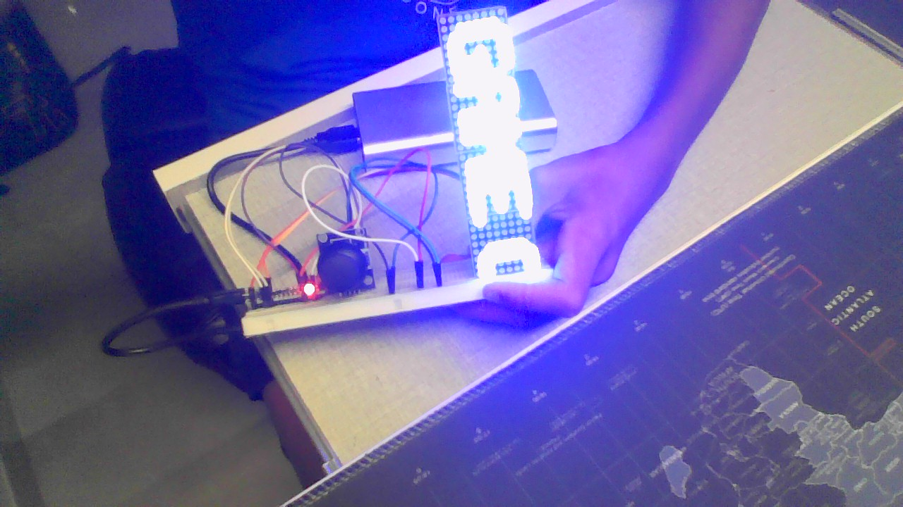

# Arduino Game Centre

A mini game centre built with an Arduino Nano, a 32×8 MAX7219 LED matrix, and a joystick.

## Games

- Catch Dot
- Snake
- Dodge
- Stack

## Features

- Game selection menu
- Joystick controls
- Score system
- Game-over screen
- Multiple mini-games on one display
- Startup messages
- Compact enclosure and CAD assembly design

## Components

- Arduino Nano
- 32×8 MAX7219 LED matrix
- Joystick module
- Jumper wires

## Wiring

### MAX7219 LED Matrix

| Matrix pin | Arduino Nano |
|---|---|
| VCC | 5V |
| GND | GND |
| DIN | D11 |
| CS | D10 |
| CLK | D13 |

### Joystick

| Joystick pin | Arduino Nano |
|---|---|
| VCC | 5V |
| GND | GND |
| VRX | A0 |
| VRY | A1 |
| SW | D3 |

## Circuit Diagram

[Open the editable circuit in Cirkit Designer](https://app.cirkitdesigner.com/project/b4dd65cf-c525-4572-8212-0d7c4e4b9e2c)

*Note: The diagram uses substitute symbols for the Arduino Nano and 32×8 LED matrix where exact components are unavailable.*

## How to Play

1. Power on the Arduino.
2. Use the joystick to navigate the game menu.
3. Press the joystick button to select a game.
4. Follow the controls implemented in the selected game.

## Project Photos

## Code

The Arduino sketch is available in [`game_centre.ino`](game_centre.ino).

## Libraries

- MD_MAX72XX
- MD_Parola
- SPI

## CAD Model

The planned assembly contains:

- `Game_Centre_Enclosure` — main enclosure with openings for the display and joystick.
- `Arduino_Nano` — simplified board model positioned inside the enclosure.
- `LED_Matrix_32x8` — display module positioned at the front opening.
- `Joystick_Module` — joystick module positioned at its opening.

The CAD model uses simplified component shapes to demonstrate the proposed physical arrangement.

<!-- Add your CAD screenshot here after uploading it to the cad folder. -->

## Project Summary

Arduino Game Centre brings several mini-games together in one compact project using an LED matrix and joystick. The project combines embedded programming, joystick input, game logic, circuit design, and enclosure modelling.
